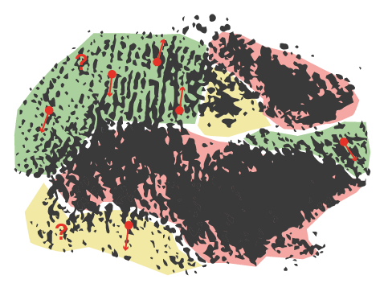

# OpenAFQA

> [!IMPORTANT]
> **This repository is archived.** No further additions are planned, and we can't guarantee further changes to the code. The code is provided as-is, as a reference for our published work on automated fingermark quality assessment.
>
> **Our research continues in [AFID](https://github.com/timoblak/AFID)**, our newest open framework for friction ridge recognition, feature extraction and quality assessment ([arXiv paper](https://arxiv.org/abs/2609.07439)). Anyone interested in this line of research is invited to follow further developments there.

The repository for developing Automated Fingermark Quality Assessment methods.

  

## Contents
    
- **[AFQA Toolbox.](afqa_toolbox)** The Automated Fingermark Quality Assessment toolbox consists of a collection of commonly used algorithms for friction ridge preprocessing and feature extraction. 
  Also included are Python implementations or wrappers of fingerprint/fingermark quality assessment methods.
- **[Toolbox examples.](toolbox_examples)** Practical examples, where the usage of the toolbox is demonstrated.
- **[Experiments.](experiments)** Code for various publications, related to automated fingermark quality assessment. 

### Toolbox Installation

1. Set up a Python (3.8 or newer) environment by installing packages in requirements.txt
2. To use the minutiae extraction wrappers, download and compile the code. For more information on this, see [minutiae extraction README](afqa_toolbox/minutiae/README.md).
3. The pre-trained models for our quality assessment methods can be downloaded from the links below. Either copy the downloaded models into `afqa_toolbox/resources/` or use a custom path at initialization.  
   - AFQA Ensemble models (2022): [link](https://unilj-my.sharepoint.com/:u:/g/personal/tim_oblak_fri1_uni-lj_si/EWsIr-hK01NJit-NN8XufwIB3uTDYcz4xBjcQ9rYA_rzHA?e=kOWa2n)
   - pAFQA model (2023): [link](https://unilj-my.sharepoint.com/:u:/g/personal/tim_oblak_fri1_uni-lj_si/IQBny4H7ToQxRZ34RGlFwj-hAWdkypPKVZoIwtRa6yJ6XHI?e=mqYpdF) 
4. The toolbox can be installed locally by running `pip install .` or `pip install -e .` if you want to modify its contents. 

**Note on the classic ensemble.** The pretrained random forest models of the classic ensemble were saved with scikit-learn 0.24 and can only be loaded with `scikit-learn<1.3` (which supports Python up to 3.11). All other parts of the toolbox, including the deep learning ensemble and pAFQA, work with current versions of the dependencies. 

### Latest updates 

- (October, 2026) **pAFQA and final release** - We added the probabilistic fingermark quality assessment model (pAFQA), which predicts a quality probability distribution, from which the final quality value and its uncertainty are calculated. Read more about this contribution in our [Sensors publication](https://doi.org/10.3390/s23084006). This final release also updates the toolbox for current Python, NumPy, PyTorch and scikit-learn versions and corrects the computation of local ridge orientation (the NFIQ 2 compatible formula is still available with `orient(..., legacy=True)` and is used by the pretrained classic ensemble). The repository is now archived; see [AFID](https://github.com/timoblak/AFID) for our ongoing work. 
- (October, 2022) **The AFQA Ensemble models** - This release includes two approaches to AFQA: (a) a classic predictive pipeline with preprocessing, feature extraction and feature vector creation steps, as well as (b) a deep learning model which processes raw fingermark images. We also include a fusion method that combines multiple quality scores into one. Read more about this contribution in our [Knowledge-Based Systems publication](https://doi.org/10.1016/j.knosys.2022.109148).      
- (September, 2021) **AFQA Toolbox** - We released the AFQA toolbox, a collection of algorithms for processing fingerprint/fingermark images, written in Python. We also provided the initial baseline models for quality assessment of fingermarks. Read more about this contribution in our [BIOSIG publication](https://doi.org/10.1109/BIOSIG52210.2021.9548318).     

 
### References
If you use our open-source software, please consider citing: 

    T. Oblak, R. Haraksim, L. Beslay, P. Peer. 
    Probabilistic Fingermark Quality Assessment with Quality Region Localisation. 
    Sensors, Volume 23, Issue 8, 4006, 2023
    
    T. Oblak, R. Haraksim, P. Peer, L. Beslay. 
    Fingermark quality assessment framework with classic and deep learning ensemble models. 
    Knowledge-Based Systems, Volume 250, 2022    

    T. Oblak, R. Haraksim, L. Beslay, P. Peer. 
    Fingermark Quality Assessment: An Open-Source Toolbox. 
    In proceedings of the International Conference of the Biometrics Special Interest Group (BIOSIG), pp. 159-170, 2021.
     
